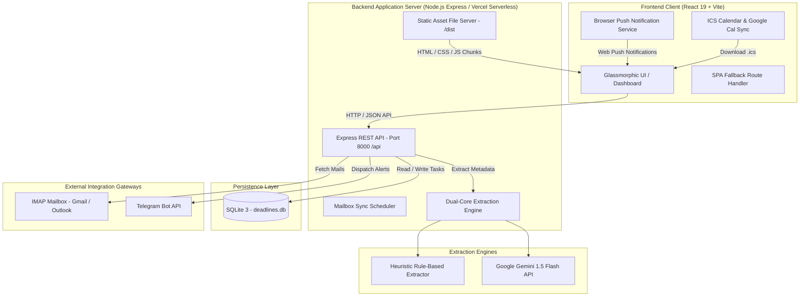
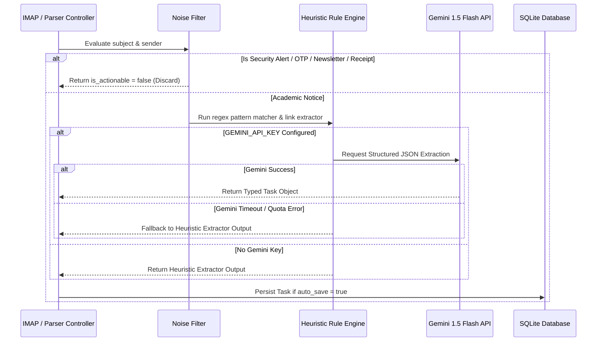

# 2. Technical Architecture Document

**Project Name:** Student Deadline Radar  
**Architecture Style:** Fullstack JavaScript (Vite React + Express Serverless)  
**Runtime:** Node.js 20+ (Express)  
**Document Version:** 1.1.0  

---

## 1. System Topology Overview



---

## 2. Technology Stack Specifications

| Layer | Component | Version | Responsibility |
| :--- | :--- | :--- | :--- |
| **Frontend** | React | `19.2.8` | Component UI rendering, state management, reactive board updates |
| | Vite | `8.3.0` | Ultra-fast bundling, HMR, code-splitting, production minification |
| | Tailwind CSS | `4.3.3` | Modern CSS styling, glassmorphism, responsive utility grid |
| | Lucide React | `1.48.0` | Consistent vector iconography |
| | Canvas Confetti | `1.9.4` | Micro-animation celebration for task completion |
| **Backend** | Node.js | `20+` | Primary server runtime, event-driven async execution |
| | Express | `4.21.2` | REST API routes, static file serving, middleware |
| | SQLite3 | `5.1.7` | Embedded relational database engine |
| | ImapFlow | `1.0.171` | High-performance IMAP client with sequence range scanning |
| | Mailparser | `3.7.2` | MIME message parsing, HTML-to-text extraction |
| | Axios | `1.7.9` | Outbound HTTP client for Telegram Bot and Gemini API |
| **Python Bridge** | Python (Optional) | `3.10+` | Alternative FastAPI server or standalone NLP model runner |

---

## 3. Database Architecture & Schema Definition

The SQLite database (`deadlines.db`) utilizes relational integrity with dynamic timestamp updating.

### 3.1 Table: `deadline_tasks`
Stores aggregated academic obligations and action items.

```sql
CREATE TABLE IF NOT EXISTS deadline_tasks (
  id INTEGER PRIMARY KEY AUTOINCREMENT,
  title VARCHAR(255) NOT NULL,
  category VARCHAR(50) DEFAULT 'other',          -- registration, hackathon, placement, feedback, exam, assignment, event, form, other
  action_required VARCHAR(255) NOT NULL,        -- Clear imperative directive for the student
  deadline_iso DATETIME,                        -- ISO 8601 UTC timestamp
  deadline_text_raw VARCHAR(100),               -- Exact textual expression in source email
  deadline_exact BOOLEAN DEFAULT 1,             -- 1 if specific hour/min known, 0 if estimated
  primary_link TEXT,                            -- Form URL (forms.gle, forms.office, unstop)
  sender VARCHAR(255),                          -- Sender email or department name
  source_subject VARCHAR(255),                  -- Original email subject line
  raw_snippet TEXT,                             -- Short snippet of email body
  urgency_tier VARCHAR(20) DEFAULT 'green',     -- 'red', 'yellow', 'green', 'overdue'
  status VARCHAR(20) DEFAULT 'active',          -- 'active', 'done', 'snoozed'
  priority_score INTEGER DEFAULT 3,             -- 1 (Critical) to 5 (Informational)
  confidence FLOAT DEFAULT 0.9,                 -- Extraction confidence score (0.0 - 1.0)
  email_thread_id VARCHAR(100),                 -- Deduplication thread key
  snoozed_until DATETIME,                       -- Timestamp when snoozed task reactivates
  created_at DATETIME DEFAULT CURRENT_TIMESTAMP,
  updated_at DATETIME DEFAULT CURRENT_TIMESTAMP
);
```

### 3.2 Table: `email_logs`
Tracks processed emails to prevent duplicate ingestion.

```sql
CREATE TABLE IF NOT EXISTS email_logs (
  id INTEGER PRIMARY KEY AUTOINCREMENT,
  message_id VARCHAR(100) UNIQUE,
  sender VARCHAR(255) NOT NULL,
  subject VARCHAR(255) NOT NULL,
  received_at DATETIME DEFAULT CURRENT_TIMESTAMP,
  is_actionable BOOLEAN DEFAULT 0,
  extracted_task_id INTEGER,
  raw_body TEXT
);
```

### 3.3 Table: `user_settings`
Stores user notification preferences and sender whitelists.

```sql
CREATE TABLE IF NOT EXISTS user_settings (
  id INTEGER PRIMARY KEY AUTOINCREMENT,
  telegram_chat_id VARCHAR(100),
  telegram_enabled BOOLEAN DEFAULT 1,
  calendar_sync_enabled BOOLEAN DEFAULT 0,
  daily_digest_time VARCHAR(10) DEFAULT '08:00',
  whitelist_senders TEXT DEFAULT 'placement@college.edu,iipc@college.edu,hod.cse@college.edu,notices@college.edu'
);
```

---

## 4. API Specification & Interface Contracts

All endpoints return JSON responses with standard HTTP status codes.

| Method | Endpoint | Request Body / Query | Description |
| :--- | :--- | :--- | :--- |
| `GET` | `/health` | None | Cloud health check returning `{ status: "ok", uptime, timestamp }`. |
| `GET` | `/api/deadlines` | `?status=active&category=all&urgency=all&search=` | Returns filtered and urgency-calculated task list. |
| `POST` | `/api/deadlines/parse-raw` | `{ subject, sender, body, sent_at, auto_save }` | Runs extraction engine on raw email string. |
| `PATCH` | `/api/deadlines/:id/action` | `{ action: "done" \| "snooze_24h" \| "reactivate" \| "delete" }` | Performs lifecycle status updates. |
| `GET` | `/api/stats` | None | Returns aggregated counts (critical, approaching, completed, streaks). |
| `GET` | `/api/sample-emails` | None | Returns pre-curated sample academic emails for testing. |
| `POST` | `/api/mailbox/test-connection` | `{ email, app_password, imap_server, port }` | Validates IMAP credentials in $< 300\text{ms}$. |
| `POST` | `/api/mailbox/fetch-real-emails` | `{ email, app_password, imap_server, port, max_emails, days }` | Scans mailbox, parses messages, saves new tasks. |
| `POST` | `/api/telegram/test-alert` | `{ task_id, bot_token, chat_id }` | Dispatches live Markdown alert to Telegram bot. |
| `POST` | `/api/python/extract` | `{ subject, sender, body, sent_at }` | Direct bridge invocation of Python NLP extractor. |

---

## 5. Dual-Engine Extraction Pipeline



### 5.1 Urgency Calculation Logic
$$T_{\text{remaining}} = \frac{\text{Deadline}_{\text{timestamp}} - \text{Now}_{\text{timestamp}}}{3600 \times 1000} \text{ hours}$$

$$\text{Urgency Tier} = \begin{cases} 
\text{overdue} & \text{if } T_{\text{remaining}} < 0 \\
\text{red} & \text{if } 0 \le T_{\text{remaining}} \le 48 \\
\text{yellow} & \text{if } 48 < T_{\text{remaining}} \le 168 \text{ (7 days)} \\
\text{green} & \text{if } T_{\text{remaining}} > 168 
\end{cases}$$

---

## 6. Deployment Architecture

The codebase supports three deployment topologies:
1. **Single-Service Monolith (Render / Railway / Docker):** Node.js Express serves both the backend API and the static `frontend/dist` SPA from the root container on a single port.
2. **Decoupled Architecture (Vercel Frontend + Render Backend):** Frontend deployed on Vercel Edge Network calling the backend API via `VITE_API_URL` with CORS credentials enabled.
3. **Containerized Volume Deployment (Docker Compose):** Multi-stage Alpine container mounting persistent SQLite data at `/app/data/deadlines.db`.
