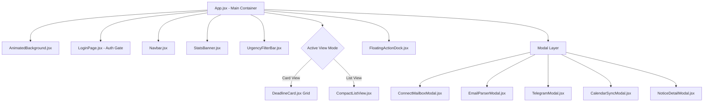

# 4. Frontend Specification Document

**Project Name:** Student Deadline Radar  
**Design System:** Cyber-Academic Glassmorphism  
**Styling Framework:** Tailwind CSS v4 + Lucide React  
**Document Version:** 1.0.0  

---

## 1. Visual Design Philosophy & Aesthetics
The Student Deadline Radar UI is engineered to transform mundane academic administrative circulars into an engaging, high-clarity **Mission Control Radar**.

### Core Aesthetic Pillars:
1. **Glassmorphism & Depth:** Layered translucent surfaces (`backdrop-blur-md`, subtle border highlights `border-white/10`).
2. **Tri-Color Urgency Coding:** Instant visual triage through high-contrast neon status beacons (🔴 Rose/Red, 🟡 Amber/Yellow, 🟢 Emerald/Green).
3. **Micro-Interactions & Gamification:** Particle confetti celebrations on task completion, smooth card transitions, pulsing urgent warnings, and animated background glow effects.

---

## 2. Color Palette & Design Tokens

```
Background:      #030712 (Tailwind Slate-950)
Card Surface:    rgba(15, 23, 42, 0.75) with 1px border rgba(255, 255, 255, 0.08)
Card Hover:      rgba(30, 41, 59, 0.85) with border rgba(56, 189, 248, 0.3)
Primary Accent:  #38bdf8 (Sky-400) / #6366f1 (Indigo-500)
Text Primary:    #f8fafc (Slate-50)
Text Muted:      #94a3b8 (Slate-400)
```

### Tri-Color Urgency Badges:
- 🔴 **Critical / Overdue (<48h):**
  - Background: `rgba(239, 68, 68, 0.15)`
  - Text & Icon: `#f87171` (`rose-400`)
  - Border: `rgba(239, 68, 68, 0.4)` with ambient ping/pulse animation.
- 🟡 **Approaching (<7 Days):**
  - Background: `rgba(245, 158, 11, 0.15)`
  - Text & Icon: `#fbbf24` (`amber-400`)
  - Border: `rgba(245, 158, 11, 0.3)`.
- 🟢 **Normal (>7 Days):**
  - Background: `rgba(16, 185, 129, 0.12)`
  - Text & Icon: `#34d399` (`emerald-400`)
  - Border: `rgba(16, 185, 129, 0.25)`.

---

## 3. Typography Hierarchy
- **Font Family:** `system-ui, -apple-system, BlinkMacSystemFont, "Segoe UI", Roboto, sans-serif`
- **Display / Brand:** `text-2xl font-black tracking-tight`
- **Section Headers:** `text-xl font-bold text-slate-100`
- **Card Titles:** `text-base font-semibold text-slate-100 line-clamp-2`
- **Action Directives:** `text-sm font-medium text-sky-300`
- **Metadata / Timestamps:** `text-xs font-mono text-slate-400`

---

## 4. Component Hierarchy & Layout



### Component Breakdown:
1. **`Navbar.jsx`:**
   - Sticky top navigation with blurred backdrop.
   - Live mailbox sync trigger with rotating spinner icon.
   - Push notifications switch with instant browser permission handshake.
   - Quick action triggers for Telegram alerts, Mailbox setup, and Logout.
2. **`StatsBanner.jsx`:**
   - 4-card metric strip: Total Active Deadlines, 🔴 Critical, 🟡 Approaching, 🟢 Normal, and 14-Day Academic Streak flame counter.
3. **`UrgencyFilterBar.jsx`:**
   - Category filter pills: All, Placement, Hackathons, Exams, Assignments, Feedback, Events, Forms.
   - Urgency tier selector pills.
   - Live debounced search input with auto-clear button.
4. **`DeadlineCard.jsx`:**
   - Glassmorphic card container with dynamic glowing hover ring.
   - Urgency pill with live countdown timer string (e.g. `2d 4h left`).
   - Category badge with context icon (`Briefcase` for placement, `Code2` for hackathon).
   - "Open Form / Link" primary action button with external link icon.
   - Secondary action menu: "Mark as Done", "Snooze 24h", "Delete".
5. **`CompactListView.jsx`:**
   - High-density tabular layout for rapid processing of large notification backlogs.
6. **`LoginPage.jsx`:**
   - Interactive `StickAnimation.jsx` welcoming the student.
   - Quick preset selector for Gmail, Outlook, or College IMAP.
   - Secure App Password help modal with step-by-step instructions.
   - Guest Mode bypass for instant demo examination.

---

## 5. Micro-Animations & Interactivity

1. **Task Completion Confetti:**
   - Triggered via `canvas-confetti` firing multi-colored celebratory particles upon marking any task "Done".
2. **Skeleton Shimmer Loading:**
   - `ShimmerSkeleton.jsx` renders animated pulse silhouettes during data refetches, eliminating layout shifts (CLS).
3. **Ambient Background Orb:**
   - `AnimatedBackground.jsx` renders subtle floating gradient blur orbs responding to the viewport.
4. **Push Notification Feedback:**
   - Audio-visual affirmation when enabling browser push notifications or testing alert dispatches.

---

## 6. Responsive Breakpoint Matrix

| Viewport | Width | Layout Adjustments |
| :--- | :--- | :--- |
| **Mobile** | $360\text{px} - 640\text{px}$ | Single-column cards, collapsed horizontal scrolling filter bar, sticky bottom action dock. |
| **Tablet** | $641\text{px} - 1024\text{px}$ | 2-column grid, compact statistics strip. |
| **Desktop** | $1025\text{px} - 1536\text{px}$ | 3-column grid, full stat banners, side-by-side modal dialogs. |
| **Ultra-Wide** | $> 1536\text{px}$ | Max content width capped at `7xl` (`1280px` - `1400px`) centered with ambient margins. |
